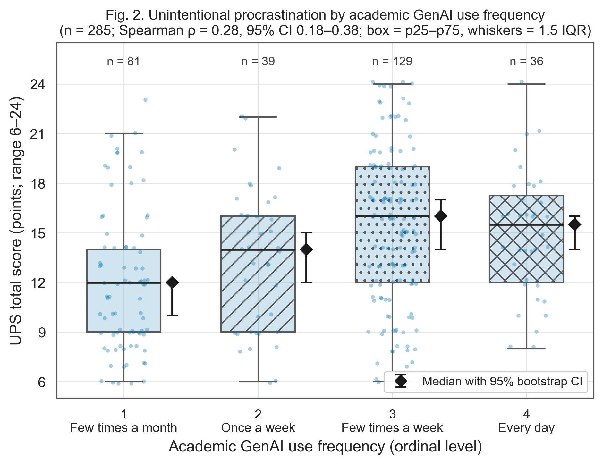
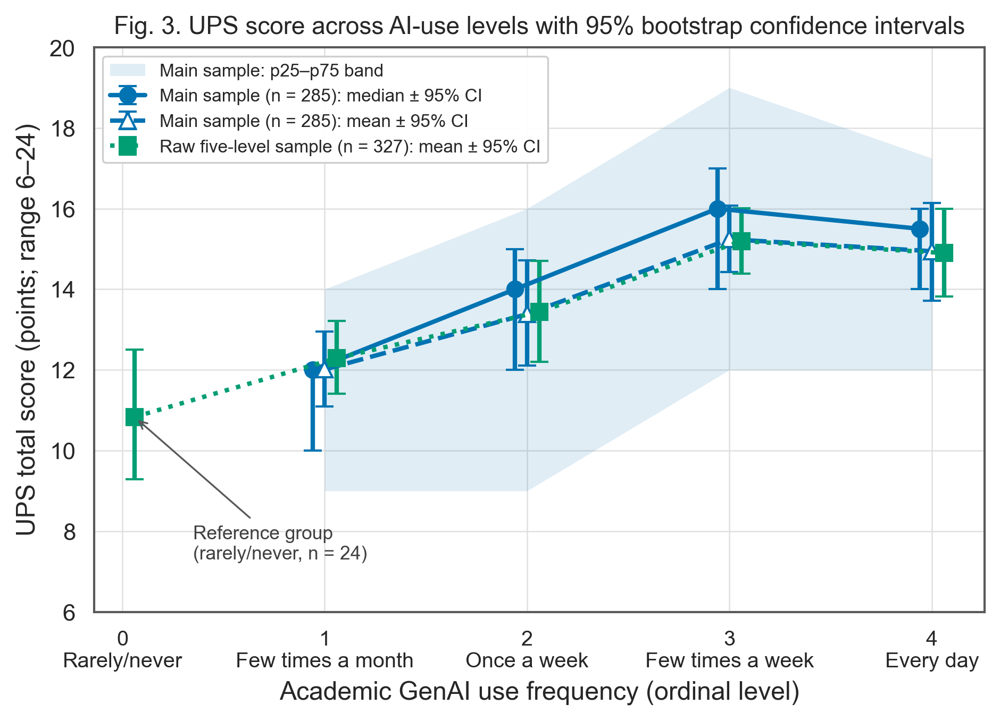
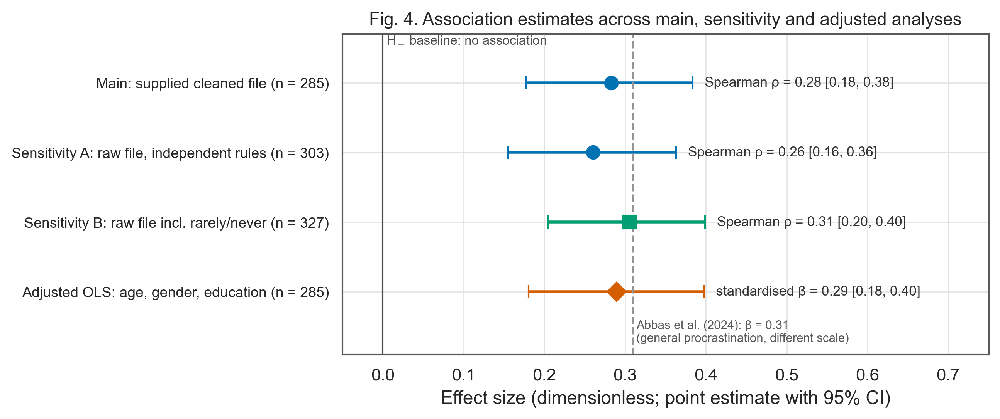
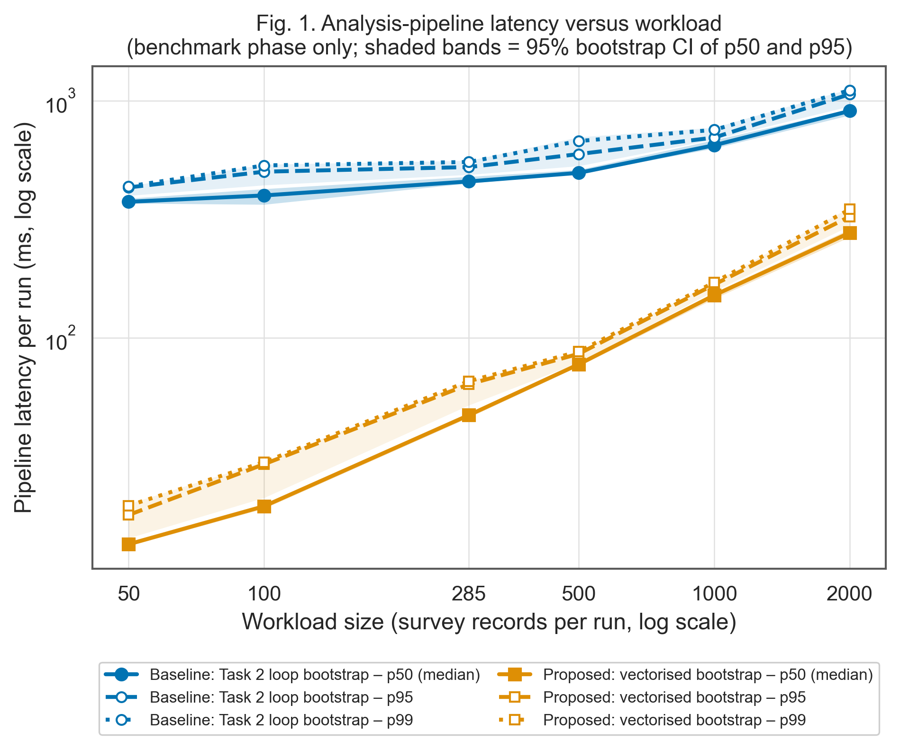
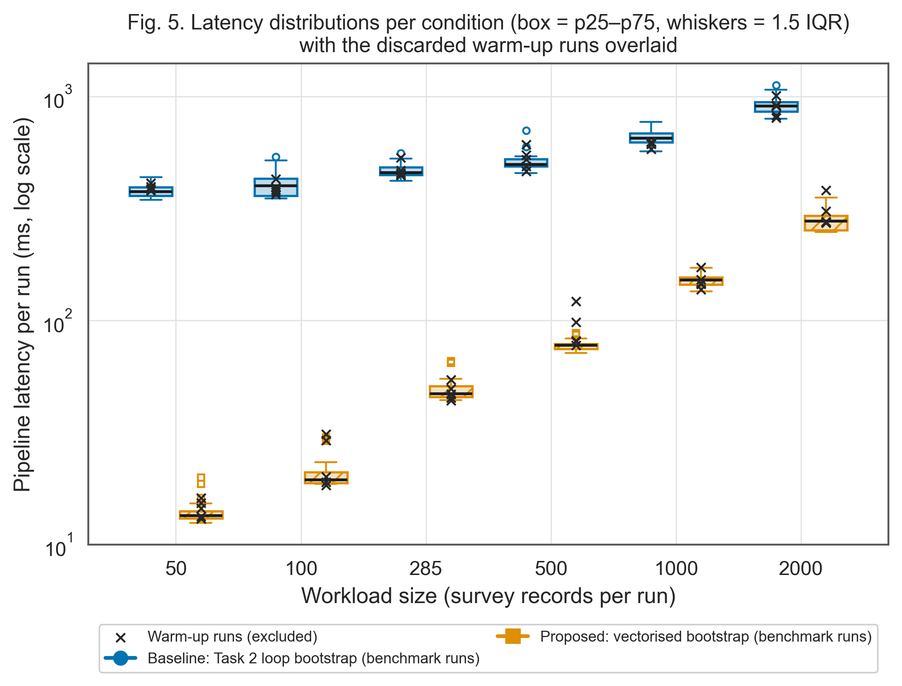

# Academic GenAI Use and Unintentional Procrastination

**Authors:** Ernur Kussain and Zhanassyl Zhakyp

**Stage:** Task 3, research results and data analysis. Weeks 7 and 8 (data collection, processing, statistics and figures) are complete; the Week 9 domain model will be added as `docs/domain_model.md`.

## Overview

This repository holds a reproducible secondary analysis of a public Indian higher-education survey (Sharma et al., 2026). It asks whether students who use generative AI more often for academic work report more unintentional procrastination. The design is observational and cross-sectional, so the results describe an association and say nothing about cause. Kazakhstan is the setting we discuss the results for, but no data come from Kazakhstan.

The work has two layers:

1. Survey layer (the research question). The two public workbooks are coded, eligibility rules are applied, the Unintentional Procrastination Scale (UPS) is scored and audited, and the association is estimated with rank statistics, reference-group comparisons and a baseline-versus-proposed regression model.
2. Pipeline layer (the measurement tool). The Week 7 collector times the Task 2 analysis function under six workloads, separates warm-up from benchmark runs, injects invalid batches to track errors as a guardrail metric, and compares the Task 2 loop bootstrap with a vectorised implementation that returns identical estimates.

## Research question and hypotheses

RQ: Is the frequency of academic GenAI use associated with unintentional procrastination in the selected sample?

* H₀: Spearman ρ = 0 between AI-use frequency (ordinal, 1 to 4) and UPS total (6 to 24).
* H₁: Spearman ρ ≠ 0. Two-sided α = 0.05.

The analysis parameters, reference groups and covariates were fixed in `configs/research.yaml` before the main association was computed. The plan is not a prospective preregistration, because published findings from the source study may have been seen beforehand.

## Data

Sharma, P., Nandy, D., Ramchandani, G., James, A., Batra, M., & Dhanda, R. (2026). *Datasheets for Role of Generative Artificial Intelligence Usage on Academic Dishonesty Among Indian Undergraduate and Postgraduate Students* (Version 1) [Data set]. Mendeley Data. https://doi.org/10.17632/88pv88j8jb.1 (CC BY 4.0).

| Sample | Source file | Eligibility | n |
|---|---|---|---|
| Main | supplied cleaned workbook (300 rows) | bachelor's or master's category, age ≥ 18 | 285 |
| Sensitivity A | raw workbook (355 rows) | independent rules: consent, bachelor's/master's, age ≥ 18 after normalising entries such as "22 years", academic AI use = yes, frequency recorded, complete UPS | 303 |
| Sensitivity B | raw workbook | as A, but respondents answering *Rarely/never* are kept as frequency level 0, the low-use reference group | 327 |

All 300 UPS totals in the cleaned workbook match our scoring exactly. The step-by-step exclusions are in `data/processed/exclusion_flow.csv`. The workbooks themselves are not committed: `src/fetch_data.py` downloads them and checks their SHA-256 hashes. The committed CSVs in `data/processed/` keep only the analysis variables (no initials, no academic-dishonesty items, no domicile).

## Methods

Survey layer. The primary metric is Spearman ρ with a 95% percentile bootstrap interval (10,000 resamples, seed 20261007), an asymptotic p-value and a 10,000-permutation p-value. Secondary statistics are the Kruskal–Wallis test across levels, per-level median, p25, p75, p95, p99 and mean ± SD with bootstrap intervals, and comparisons of every level with the lowest-use reference group (median difference, Cliff's δ, Mann–Whitney with Holm correction). The supplementary model compares a baseline OLS regression (age, gender, education) with a proposed model that adds AI-use frequency, using HC3 robust standard errors. Survey guardrails stop the analysis if any required value is invalid or missing, an ID repeats, a total falls outside 6 to 24, a computed total disagrees with the supplied total, or a variable is constant.

Pipeline layer. `src/collector.py` times one call of validate → score → Spearman with bootstrap CI (1,000 resamples) using `time.perf_counter_ns`. Workloads of 50 to 2,000 records are drawn with replacement from the 285 real records. Each of the 12 conditions has 5 warm-up runs, which are logged and then discarded, and 30 benchmark runs. The order of the two implementations alternates between repetitions, and records are written only after timing ends. About 10% of benchmark runs receive an invalid batch (missing item, out-of-range value, duplicate ID or constant exposure). These runs must be rejected, and they are counted rather than dropped. Latency is summarised as p50, p95 and p99 with bootstrap intervals; outliers are flagged with the 1.5 × IQR rule but kept.

Baselines used for comparison:

| Baseline | Layer | Compared with |
|---|---|---|
| H₀: ρ = 0 | survey | observed Spearman ρ |
| Lowest-use reference group (*few times a month* in the main sample; *rarely/never* in Sensitivity B) | survey | every higher use level |
| Covariates-only OLS model | survey | model with AI-use frequency added |
| Published estimate: Abbas et al. (2024), β = 0.309 for ChatGPT use and general procrastination | survey | our standardised β (different scale, so only a rough reference) |
| Task 2 loop bootstrap (`benchmark.association`) | pipeline | vectorised bootstrap (`process_data.spearman_bootstrap`) |

## Results and discussion

### Summary: baseline versus proposed

| Comparison | Baseline | Proposed / exposed | Difference or effect [95% CI] |
|---|---|---|---|
| UPS score (points), main sample: reference group *few times a month* (n = 81) vs *a few times a week or daily* (n = 165) | 12.0 (9–14); 12.01 ± 4.29 | 16.0 (12–18); 15.18 ± 4.57 | Spearman ρ over all four levels = 0.283 [0.177, 0.384] |
| UPS score (points), raw five-level sample: reference group *rarely/never* (n = 24) vs *a few times a week or daily* (n = 173) | 10.5 (7–14); 10.83 ± 4.11 | 15.0 (12–18); 15.13 ± 4.53 | Spearman ρ over five levels = 0.305 [0.205, 0.399] |
| Explained variance of UPS: covariates-only model vs + AI-use frequency (n = 285) | R² = 0.004 | R² = 0.086 | ΔR² = 0.081; F = 24.9, p < 0.001 |
| Pipeline latency (ms) at n = 285 records: Task 2 loop vs vectorised bootstrap | 456.4 (445.9–483.3); 467.7 ± 33.4 | 47.2 (45.5–51.0); 49.2 ± 5.9 | speed-up of p50 = 9.67× [9.27, 10.31] |

Values are Median (p25–p75); Mean ± SD.

### Primary test and sensitivity analyses

| Analysis | n | Spearman ρ [95% bootstrap CI] | p (asymptotic) | p (permutation) | Kruskal–Wallis H, ε² | Decision |
|---|---|---|---|---|---|---|
| Main: supplied cleaned workbook | 285 | 0.283 [0.177, 0.384] | 1.2e-06 | < 0.001 | 26.4, 0.093 | Reject H₀ |
| Sensitivity A: raw workbook, independent rules | 303 | 0.260 [0.155, 0.363] | 4.4e-06 | < 0.001 | 23.7, 0.078 | Reject H₀ |
| Sensitivity B: raw workbook, five levels incl. rarely/never | 327 | 0.305 [0.205, 0.399] | 1.8e-08 | < 0.001 | 34.0, 0.104 | Reject H₀ |

All 10,000 bootstrap resamples were valid in every analysis. UPS internal consistency in the main sample is Cronbach's α = 0.89.





### Comparison with the lowest-use reference group

| AI-use level | n | Median (p25–p75) | Median 95% CI | Mean ± SD | Mean 95% CI | Median difference vs reference [95% CI] | Cliff's δ [95% CI] | Holm p |
|---|---|---|---|---|---|---|---|---|
| **Main sample (n = 285)** | | | | | | | | |
| 1: Few times a month | 81 | 12.0 (9–14) | [10.0, 12.0] | 12.01 ± 4.29 | [11.10, 12.95] | reference | reference |  |
| 2: Once a week | 39 | 14.0 (9–16) | [12.0, 15.0] | 13.38 ± 4.23 | [12.10, 14.72] | +2.0 [+0.0, +5.0] | 0.21 [-0.01, 0.42] | 0.067 |
| 3: Few times a week | 129 | 16.0 (12–19) | [14.0, 17.0] | 15.24 ± 4.78 | [14.43, 16.07] | +4.0 [+2.0, +6.0] | 0.39 [0.23, 0.53] | < 0.001 |
| 4: Every day | 36 | 15.5 (12–17) | [14.0, 16.0] | 14.94 ± 3.77 | [13.72, 16.14] | +3.5 [+2.0, +6.0] | 0.41 [0.21, 0.60] | < 0.001 |
| **Raw five-level sample (n = 327)** | | | | | | | | |
| 0: Rarely/never | 24 | 10.5 (7–14) | [8.0, 13.0] | 10.83 ± 4.11 | [9.29, 12.50] | reference | reference |  |
| 1: Few times a month | 89 | 12.0 (9–15) | [10.0, 13.0] | 12.29 ± 4.41 | [11.40, 13.21] | +1.5 [-2.0, +4.0] | 0.19 [-0.08, 0.45] | 0.159 |
| 2: Once a week | 41 | 14.0 (9–16) | [12.0, 15.0] | 13.44 ± 4.15 | [12.20, 14.71] | +3.5 [+0.0, +6.5] | 0.36 [0.09, 0.62] | 0.032 |
| 3: Few times a week | 133 | 15.0 (12–19) | [14.0, 17.0] | 15.20 ± 4.78 | [14.38, 16.02] | +4.5 [+2.0, +8.0] | 0.51 [0.29, 0.69] | < 0.001 |
| 4: Every day | 40 | 15.5 (12–17) | [14.0, 16.0] | 14.90 ± 3.64 | [13.82, 16.00] | +5.0 [+2.0, +8.0] | 0.54 [0.28, 0.76] | < 0.001 |

Weekly use does not differ clearly from the monthly reference group; the intervals include zero. Respondents who use AI a few times a week or every day score about 3 to 4 UPS points higher than the monthly group and 4 to 5 points higher than the rarely/never group. Scores rise from monthly to *a few times a week* and stay at that level for daily users.

### Baseline versus proposed model

Age, gender and education together explain almost none of the variance in UPS. Adding AI-use frequency gives β = 1.30 UPS points per frequency level (HC3 95% CI [0.81, 1.79]) and a standardised β of 0.29 [0.18, 0.40]. Treating frequency as categorical gives a similar gain (ΔR² = 0.093). Residuals are not normal (Shapiro–Wilk p = 0.001), which is why HC3 errors are reported and the rank test remains the primary analysis; the Breusch–Pagan test does not indicate heteroscedasticity (p = 0.18).



### Pipeline benchmark (Weeks 7 and 8)

The log `data/raw/test_run.jsonl` has 420 records: 60 warm-up records were discarded and 360 benchmark records were analysed. It was collected on Intel(R) Xeon(R) Processor @ 2.80GHz (2 logical CPUs, 7.84 GB RAM), Python 3.12.3, Linux-6.18.44-fc-v180-x86_64-with-glibc2.39.

| Records per run | Implementation | Runs ok / total | p50 ms [95% CI] | p95 ms [95% CI] | p99 ms | Mean ± SD ms | Unexpected error rate | Invalid batches rejected |
|---|---|---|---|---|---|---|---|---|
| 50 | Baseline (Task 2 loop) | 27 / 30 | 374.6 [369.0, 387.1] | 430.7 [397.8, 436.1] | 435.2 | 381.2 ± 26.4 | 0% | 3 / 3 |
| 50 | Proposed (vectorised) | 27 / 30 | 13.5 [13.3, 13.8] | 17.9 [14.3, 19.9] | 19.6 | 14.0 ± 1.7 | 0% | 3 / 3 |
| 100 | Baseline (Task 2 loop) | 27 / 30 | 398.5 [365.0, 424.7] | 501.9 [440.4, 538.4] | 533.3 | 402.4 ± 50.8 | 0% | 3 / 3 |
| 100 | Proposed (vectorised) | 27 / 30 | 19.5 [19.1, 19.8] | 29.3 [21.2, 30.1] | 29.9 | 20.8 ± 3.3 | 0% | 3 / 3 |
| 285 | Baseline (Task 2 loop) | 23 / 30 | 456.4 [448.4, 478.1] | 524.8 [487.6, 558.6] | 551.5 | 467.7 ± 33.4 | 0% | 7 / 7 |
| 285 | Proposed (vectorised) | 23 / 30 | 47.2 [46.1, 48.3] | 63.7 [52.0, 65.9] | 65.6 | 49.2 ± 5.9 | 0% | 7 / 7 |
| 500 | Baseline (Task 2 loop) | 26 / 30 | 496.2 [492.8, 511.5] | 595.5 [530.4, 702.3] | 675.7 | 511.8 ± 52.0 | 0% | 4 / 4 |
| 500 | Proposed (vectorised) | 26 / 30 | 77.3 [75.9, 78.4] | 85.6 [78.6, 88.0] | 87.6 | 77.6 ± 4.1 | 0% | 4 / 4 |
| 1000 | Baseline (Task 2 loop) | 25 / 30 | 648.8 [629.5, 682.4] | 699.1 [686.5, 770.2] | 753.2 | 652.8 ± 42.8 | 0% | 5 / 5 |
| 1000 | Proposed (vectorised) | 25 / 30 | 151.2 [146.2, 155.2] | 167.8 [157.4, 172.0] | 171.3 | 150.9 ± 9.3 | 0% | 5 / 5 |
| 2000 | Baseline (Task 2 loop) | 27 / 30 | 905.3 [868.6, 917.7] | 1065.0 [947.0, 1120.8] | 1107.4 | 906.8 ± 83.4 | 0% | 3 / 3 |
| 2000 | Proposed (vectorised) | 27 / 30 | 277.3 [266.2, 287.4] | 324.7 [296.3, 354.1] | 348.1 | 279.0 ± 26.3 | 0% | 3 / 3 |

In 155 paired runs on identical inputs, the two implementations returned the same ρ and interval limits (largest absolute difference 2.2e-16). The vectorised version was faster at every workload, from 3.3× at 2000 records to 27.8× at 50 records. The advantage is largest for small inputs, where the loop spends most of its time on the fixed overhead of 1,000 separate SciPy calls; for larger inputs the ranking work itself takes up more of the run time in both versions. No unexpected errors occurred, and every injected invalid batch was rejected. Latency was summarised from successful runs, and `p95_all_runs_ms` in `data/processed/pipeline_latency_summary.csv` reports the p95 with rejected runs included. These timings come from one machine and are engineering diagnostics only.





### Discussion

In this sample, more frequent academic GenAI use goes with more unintentional procrastination. The association is small to moderate (ρ ≈ 0.28, 95% CI [0.18, 0.38]), and the two raw-file analyses give similar estimates (ρ = 0.26 and 0.31), so the authors' unexplained exclusions do not appear to drive it. Our standardised β of 0.29 is close to the β = 0.309 that Abbas et al. (2024) report for ChatGPT use and general procrastination. That study used a different scale, model and population, so the agreement is only a consistency check.

Several limits apply. The data are cross-sectional self-reports, so the direction is unknown: students who already delay may turn to AI more, or workload may drive both. UPS measures unintentional procrastination in general, while Task 1 asked about academic procrastination. The source is a convenience sample recruited online in India, and its education categories mix graduates with current students. The frequency item is ordinal, so the linear model term is an approximation. For Kazakhstan, these results suggest a hypothesis to test with local data; they do not estimate a local effect.

## Domain model

Planned for Week 9 (`docs/domain_model.md`).

## System requirements

* Python 3.12 or 3.13 (tested: 3.12 on Linux, 3.13 on Linux; the Task 2 pipeline was also tested on Windows with 3.13.7).
* Package versions are pinned in `requirements.txt`; `requirements-lock.txt` pins every transitive dependency of the tested environment.
* A standard CPU and about 1 GB of free RAM. No GPU is needed.
* Internet is needed only to install packages and, optionally, to download the source workbooks.

## Quickstart

From the repository root, in a fresh virtual environment:

```bash
python -m pip install -r requirements.txt
python -m unittest discover -s tests -v
python src/run_pipeline.py
```

The last command re-computes all statistics from the committed `data/processed/` files and the committed benchmark log, then writes `data/processed/metrics_summary.csv`, `reports/results.json` and the figures in `reports/figures/` (PDF and 300 DPI PNG). It takes about 10 seconds.

To re-execute the notebook from top to bottom:

```bash
jupyter nbconvert --to notebook --execute --inplace notebooks/01_data_analysis.ipynb
```

Optional steps:

```bash
python src/run_pipeline.py --fetch      # download both workbooks, verify SHA-256, re-code them
python src/collector.py                 # re-collect data/raw/test_run.jsonl (about 2 to 3 minutes)
```

Re-collecting replaces the committed log, so timings and the latency tables will change with the machine. For an isolated run, close background applications or use Docker with fixed limits:

```bash
docker build -t task3-kussain-zhakyp .
docker run --rm task3-kussain-zhakyp
docker run --rm --cpus=2 --memory=2g -v "$PWD/data:/app/data" task3-kussain-zhakyp python src/collector.py
```

## Repository structure

```text
configs/research.yaml          All parameters: paths, hashes, seed, resamples, workloads, edge cases
configs/sample.json            Task 2 synthetic smoke-test configuration
data/raw/test_run.jsonl        Week 7 benchmark log (warm-up and benchmark phases)
data/raw/test_run_meta.json    Hardware, OS and package metadata of that run
data/processed/                Coded survey data, exclusion flow, summary tables, metrics_summary.csv
data/sample/                   Ten synthetic rows used by the Task 2 smoke test
docs/                          Methodology card, data dictionary, validation record
notebooks/01_data_analysis.ipynb   Executed analysis notebook
reports/figures/               fig1 to fig5 as PDF and 300 DPI PNG
reports/results.json           All estimates, guardrails, hashes and package versions
src/fetch_data.py              Download and hash check of the source workbooks
src/process_data.py            Coding, eligibility, statistics and benchmark aggregation
src/collector.py               Week 7 measurement harness
src/visualize.py               Figure module
src/run_pipeline.py            One-command entry point
src/benchmark.py               Task 2 pipeline (unchanged; the baseline implementation)
tests/                         24 unit tests
```

## Citation and licence

Original code and the synthetic fixture are released under the MIT licence (`LICENSE`). The source dataset is CC BY 4.0 and must be cited as above when the derived files in `data/processed/` are reused. Citation metadata for this repository is in `CITATION.cff`.

Abbas, M., Jam, F. A., & Khan, T. I. (2024). Is it harmful or helpful? Examining the causes and consequences of generative AI usage among university students. *International Journal of Educational Technology in Higher Education, 21*(1), 10. https://doi.org/10.1186/s41239-024-00444-7
