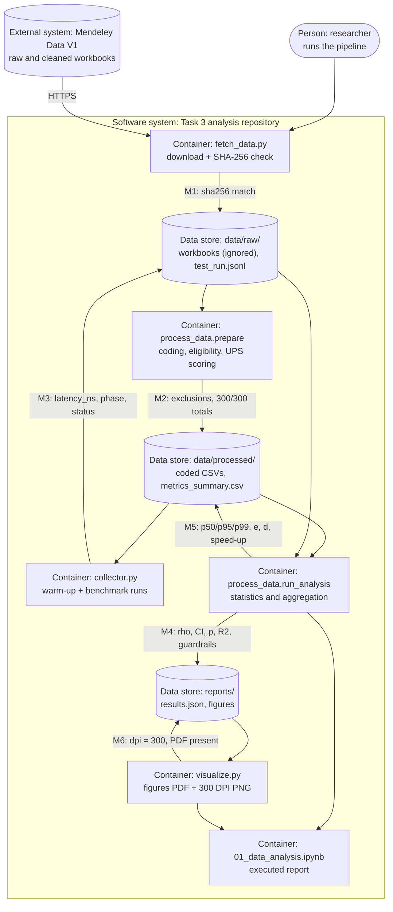

# Domain model

**Authors:** Ernur Kussain and Zhanassyl Zhakyp

Track: ML/AI, as a formal mathematical model of the target variable, the estimators, the loss function ℒ of the supplementary regression and the evaluation metrics. Section 6 adds a C4 container diagram with the metric collection points of the pipeline, and Section 7 a STRIDE threat matrix for the data flow, so the model covers the mathematical, architectural and security views of the study. Every formula names the function in `src/` that implements it.

## 1. Problem formulation

The study asks whether academic GenAI-use frequency is associated with unintentional procrastination. In the language of a learning problem:

* unit of analysis: one survey respondent $i \in \{1, \dots, n\}$;
* target $y_i$: the UPS total of respondent $i$;
* exposure $x_i$: the ordinal AI-use frequency;
* covariates $\mathbf{z}_i$: age, gender and education category;
* estimand: the population rank correlation $\rho_s$ between $x$ and $y$ (primary), and the regression coefficient $\beta$ of $x$ after adjustment for $\mathbf{z}$ (supplementary).

The data set is

```math
\mathcal{D} = \{(x_i, y_i, \mathbf{z}_i)\}_{i=1}^{n}, \qquad n = 285 \text{ (main)},\; 303 \text{ (sensitivity A)},\; 327 \text{ (sensitivity B)}.
```

The target is the sum of six item responses:

```math
y_i \;=\; \sum_{k=1}^{6} \underbrace{u_{ik}}_{\in\{1,2,3,4\}} \;\in\; \{6, 7, \dots, 24\}. \tag{1}
```

Implemented in `process_data.code_frame` and audited against the supplied totals in `process_data.prepare_cleaned` (300 of 300 equal).

## 2. Notation

| Symbol | Kind | Domain | Meaning |
|---|---|---|---|
| $n$ | scalar | $\mathbb{N}$ | number of respondents in the analysed sample |
| $i, j$ | index | $\{1,\dots,n\}$ | respondent |
| $k$ | index | $\{1,\dots,6\}$ | UPS item |
| $u_{ik}$ | scalar | $\{1,2,3,4\}$ | coded answer of respondent $i$ to UPS item $k$ |
| $\mathbf{U}$ | matrix | $\{1,\dots,4\}^{n \times 6}$ | item-response matrix |
| $y_i$ | scalar | $\{6,\dots,24\}$ | UPS total (target), Eq. (1) |
| $x_i$ | scalar | $\mathcal{X}=\{1,2,3,4\}$; $\{0,\dots,4\}$ in sensitivity B | academic AI-use frequency (exposure) |
| $\mathbf{z}_i$ | vector | $\mathbb{R}^{q}$ | covariates: age, gender dummy, education dummy ($q = 3$) |
| $\mathbf{y}, \mathbf{x}$ | vectors | $\mathbb{R}^{n}$ | stacked target and exposure |
| $\mathbf{Z}$ | matrix | $\mathbb{R}^{n \times (q+1)}$ | covariate design matrix with intercept column |
| $\mathbf{X}_1$ | matrix | $\mathbb{R}^{n \times (q+2)}$ | $[\mathbf{Z}, \mathbf{x}]$, design matrix of the proposed model |
| $R(\cdot)$ | function | $\mathbb{R}^{n} \to \mathbb{R}^{n}$ | average-rank transform (ties receive the mean rank) |
| $\rho_s, \hat\rho_s$ | scalar | $[-1, 1]$ | population and sample Spearman correlation |
| $B$ | scalar | $10\,000$ | bootstrap and permutation resamples |
| $I_b$ | vector | $\{1,\dots,n\}^{n}$ | indices of bootstrap resample $b$, drawn with replacement |
| $\mathcal{B}_{\text{valid}}$ | set | $\subseteq \{1,\dots,B\}$ | resamples in which neither variable is constant |
| $Q_p(\cdot)$ | function | | empirical $p$-quantile (linear interpolation) |
| $\gamma, \beta$ | parameters | $\mathbb{R}^{q+1}, \mathbb{R}$ | covariate coefficients; AI-frequency coefficient |
| $\boldsymbol{\theta}$ | vector | $\mathbb{R}^{q+2}$ | $(\gamma, \beta)$ |
| $\mathcal{L}(\boldsymbol\theta)$ | function | $\mathbb{R}^{q+2} \to \mathbb{R}_{\ge 0}$ | squared-error loss of the regression |
| $G_\ell$ | set | | respondents with $x_i = \ell$ |
| $\ell_0$ | scalar | $\mathcal{X}$ | reference (lowest-use) level: 1 in the main sample, 0 in sensitivity B |
| $\mathcal{R}$ | set | | all timed runs in `data/raw/test_run.jsonl` |
| $\mathcal{R}_{\text{warm}}, \mathcal{R}_{\text{bench}}$ | sets | $\mathcal{R}_{\text{warm}} \cup \mathcal{R}_{\text{bench}} = \mathcal{R}$ | warm-up runs (discarded) and benchmark runs |
| $L_r$ | scalar | $\mathbb{R}_{>0}$, ms | latency of run $r$ |
| $m \in \{\text{base}, \text{vec}\}$ | label | | implementation: Task 2 loop or vectorised |
| $w$ | scalar | $\{50, 100, 285, 500, 1000, 2000\}$ | workload, records per run |

## 3. Primary metric and hypotheses

Spearman's coefficient is the Pearson correlation of the average ranks:

```math
\hat\rho_s \;=\; \frac{\sum_{i=1}^{n}\bigl(R(\mathbf{x})_i - \bar R_x\bigr)\bigl(R(\mathbf{y})_i - \bar R_y\bigr)}
{\sqrt{\sum_{i=1}^{n}\bigl(R(\mathbf{x})_i - \bar R_x\bigr)^2}\;\sqrt{\sum_{i=1}^{n}\bigl(R(\mathbf{y})_i - \bar R_y\bigr)^2}} . \tag{2}
```

```math
H_0:\ \rho_s = 0 \qquad\text{vs.}\qquad H_1:\ \rho_s \neq 0, \qquad \alpha = 0.05 \text{ (two-sided)}. \tag{3}
```

Decision rule: reject $H_0$ when $p < \alpha$ and every guardrail in Section 5 holds. Implemented in `process_data.association_block`.

### 3.1 Uncertainty: percentile bootstrap

For $b = 1, \dots, B$ the index vector $I_b$ is drawn uniformly with replacement, keeping each pair $(x_i, y_i)$ together:

```math
\hat\rho^{*}_{b} = \hat\rho_s\bigl(\mathbf{x}_{I_b}, \mathbf{y}_{I_b}\bigr), \qquad
\mathrm{CI}_{95\%} = \Bigl[\,Q_{0.025}\bigl(\{\hat\rho^{*}_{b}\}_{b \in \mathcal{B}_{\text{valid}}}\bigr),\;
Q_{0.975}\bigl(\{\hat\rho^{*}_{b}\}_{b \in \mathcal{B}_{\text{valid}}}\bigr)\Bigr]. \tag{4}
```

```math
v = \frac{|\mathcal{B}_{\text{valid}}|}{B} \;\ge\; 0.95 . \tag{5}
```

Implemented twice with identical resample indices: `benchmark.association` (Task 2 loop, the engineering baseline) and `process_data.spearman_bootstrap` (vectorised).

### 3.2 Permutation p-value

With $\pi_b$ a random permutation of $\{1,\dots,n\}$:

```math
p_{\text{perm}} \;=\; \frac{1 + \sum_{b=1}^{B} \mathbb{1}\bigl[\,|\hat\rho_s(\mathbf{x}, \mathbf{y}_{\pi_b})| \ge |\hat\rho_s(\mathbf{x}, \mathbf{y})|\,\bigr]}{B + 1}. \tag{6}
```

The smallest attainable value is $1/(B+1) \approx 10^{-4}$. Implemented in `process_data.permutation_p_spearman`.

## 4. Loss function and the baseline-versus-proposed model

The supplementary model is a linear regression fitted by ordinary least squares. The baseline model $M_0$ uses the covariates only; the proposed model $M_1$ adds AI-use frequency:

```math
M_0:\; y_i = \mathbf{z}_i^{\top}\gamma + \varepsilon_i, \qquad
M_1:\; y_i = \mathbf{z}_i^{\top}\gamma + \beta\,x_i + \varepsilon_i . \tag{7}
```

The loss that is minimised is the mean squared error:

```math
\mathcal{L}(\boldsymbol\theta) \;=\; \frac{1}{n}\sum_{i=1}^{n}\Bigl(\,\underbrace{y_i}_{\text{observed UPS}} - \underbrace{\mathbf{z}_i^{\top}\gamma - \beta x_i}_{\text{predicted UPS } \hat y_i}\Bigr)^{2},
\qquad
\hat{\boldsymbol\theta} = \arg\min_{\boldsymbol\theta}\, \mathcal{L}(\boldsymbol\theta) = (\mathbf{X}_1^{\top}\mathbf{X}_1)^{-1}\mathbf{X}_1^{\top}\mathbf{y}. \tag{8}
```

Why squared error is acceptable here: UPS is bounded in $[6, 24]$, so no respondent can pull the fit with an extreme value, and the model is only supplementary. The primary metric, Eq. (2), works on ranks and is insensitive to outliers. A mean absolute error loss would estimate a conditional median instead of a conditional mean; it was not fitted.

Model comparison:

```math
R^2_m = 1 - \frac{\mathrm{SSR}_m}{\sum_i (y_i - \bar y)^2}, \qquad
\Delta R^2 = R^2_{1} - R^2_{0}, \qquad
F = \frac{(\mathrm{SSR}_0 - \mathrm{SSR}_1)/1}{\mathrm{SSR}_1/(n - q - 2)} . \tag{9}
```

Because the residuals are not normal (Shapiro–Wilk $p = 0.001$), the interval for $\beta$ uses the HC3 covariance estimator, with $e_i$ the residuals and $h_{ii}$ the leverages:

```math
\widehat{\mathrm{Var}}_{\text{HC3}}(\hat{\boldsymbol\theta}) = (\mathbf{X}_1^{\top}\mathbf{X}_1)^{-1}\,
\mathbf{X}_1^{\top}\operatorname{diag}\!\Bigl(\frac{e_i^{2}}{(1-h_{ii})^{2}}\Bigr)\mathbf{X}_1\,(\mathbf{X}_1^{\top}\mathbf{X}_1)^{-1}. \tag{10}
```

The standardised coefficient $\beta_{\text{std}} = \beta\, s_x / s_y$ makes the estimate comparable with published path coefficients. Implemented in `process_data.ols_models`.

## 5. Secondary metrics and constraints

Kruskal–Wallis across the $g$ use levels, with $\bar R_\ell$ the mean rank of $y$ in $G_\ell$ and $n_\ell = |G_\ell|$ (tie correction omitted from the display):

```math
H = \frac{12}{n(n+1)} \sum_{\ell=1}^{g} n_\ell \bar R_\ell^{\,2} - 3(n+1), \qquad \varepsilon^2 = \frac{H}{n-1}. \tag{11}
```

Cliff's δ of level $\ell$ against the reference level $\ell_0$:

```math
\delta_{\ell} = \frac{1}{|G_\ell|\,|G_{\ell_0}|} \sum_{i \in G_\ell} \sum_{j \in G_{\ell_0}} \operatorname{sign}(y_i - y_j) \;\in\; [-1, 1]. \tag{12}
```

The $m$ Mann–Whitney p-values are Holm-adjusted: with ordered $p_{(1)} \le \dots \le p_{(m)}$, $\tilde p_{(k)} = \max_{j \le k} \min\{1, (m - j + 1)\,p_{(j)}\}$.

Internal consistency of the six UPS items:

```math
\alpha_{\text{C}} = \frac{6}{5}\Bigl(1 - \frac{\sum_{k=1}^{6} s^{2}_{u_k}}{s^{2}_{y}}\Bigr). \tag{13}
```

The analysis is valid only inside a feasible set defined by hard constraints (the survey guardrails, `process_data.survey_guardrails`):

```math
\mathcal{C} = \Bigl\{\, u_{ik} \in \{1,2,3,4\}\ \forall i,k;\;\; y_i = \textstyle\sum_k u_{ik} = y_i^{\text{supplied}};\;\; \text{IDs unique};\;\; |\{x_i\}| \ge 2;\;\; |\{y_i\}| \ge 2;\;\; v \ge 0.95 \,\Bigr\}. \tag{14}
```

## 6. Pipeline metrics (engineering layer)

Benchmark runs exclude the warm-up runs, and latency statistics use the successful runs of each condition $(m, w)$:

```math
\mathcal{R}_{\text{bench}} = \mathcal{R} \setminus \mathcal{R}_{\text{warm}}, \qquad
\mathcal{R}^{\text{ok}}_{m,w} = \{\, r \in \mathcal{R}_{\text{bench}} : \text{status}_r = \text{ok},\ m_r = m,\ w_r = w \,\}. \tag{15}
```

```math
\mathrm{p}50_{m,w} = Q_{0.50}\bigl(\{L_r\}_{r \in \mathcal{R}^{\text{ok}}_{m,w}}\bigr), \quad
\mathrm{p}95_{m,w} = Q_{0.95}(\cdot), \quad
\mathrm{p}99_{m,w} = Q_{0.99}(\cdot). \tag{16}
```

Speed-up of the proposed implementation, with a bootstrap interval obtained by resampling the runs of each implementation independently:

```math
\mathcal{S}(w) = \frac{\mathrm{p}50_{\text{base},w}}{\mathrm{p}50_{\text{vec},w}} . \tag{17}
```

Guardrail metrics, with $\mathcal{R}^{\text{inj}}$ the runs that received an invalid batch:

```math
e = \frac{|\{ r \in \mathcal{R}_{\text{bench}} : \text{status}_r = \text{error} \}|}{|\mathcal{R}_{\text{bench}}|} = 0, \qquad
d = \frac{|\{ r \in \mathcal{R}^{\text{inj}} : \text{status}_r = \text{rejected} \}|}{|\mathcal{R}^{\text{inj}}|} = 1, \tag{18}
```

```math
\max_{r}\; \bigl|\hat\rho^{\,\text{base}}_r - \hat\rho^{\,\text{vec}}_r\bigr| \le 10^{-9} \quad \text{(identical inputs)}. \tag{19}
```

A run is flagged as an outlier, but kept, when $L_r \notin [Q_{0.25} - 1.5\,\mathrm{IQR},\; Q_{0.75} + 1.5\,\mathrm{IQR}]$. Implemented in `process_data.filter_warmup`, `latency_summary`, `speedup_table`, `estimate_agreement` and `flag_outliers_iqr`.

## 7. Values of the model on the committed data

| Quantity | Equation | Main sample ($n = 285$) |
|---|---|---|
| $\hat\rho_s$ [95% CI] | (2), (4) | 0.283 [0.177, 0.384] |
| $v$ | (5) | 1.00 |
| $p_{\text{perm}}$ | (6) | $< 0.001$ ($1/10\,001$) |
| $R^2_0 \to R^2_1$, $\Delta R^2$ | (9) | 0.004 → 0.086, ΔR² = 0.081 |
| $\hat\beta$ [HC3 95% CI], $\beta_{\text{std}}$ | (8), (10) | 1.30 [0.81, 1.79], 0.29 |
| $H$, $\varepsilon^2$ | (11) | 26.4, 0.093 |
| $\alpha_{\text{C}}$ | (13) | 0.89 |
| $\mathcal{S}(285)$ [95% CI] | (17) | 9.67 [9.27, 10.31] |
| $e$, $d$ | (18) | 0, 1 (25 of 25 invalid batches rejected) |
| max difference | (19) | $2.2 \times 10^{-16}$ |

## 8. C4 container view with metric collection points



| Point | Where it is measured | What is recorded |
|---|---|---|
| M1 | `fetch_data.fetch` | SHA-256 of each workbook against `configs/research.yaml` |
| M2 | `process_data.prepare` | exclusion counts per rule, computed vs supplied UPS totals |
| M3 | `collector.collect` | `latency_ns`, `phase`, `status`, `edge_case`, estimates per run |
| M4 | `process_data.run_analysis` | Eqs. (2)–(14), survey guardrails, input hashes |
| M5 | `process_data.latency_summary`, `speedup_table` | Eqs. (15)–(19) |
| M6 | `visualize.make_all` | file presence and PNG resolution |

## 9. STRIDE threat matrix for the data flow

| Threat | Component at risk | Example | Mitigation in this repository | Residual risk |
|---|---|---|---|---|
| Spoofing | source workbooks | a mirror serves a different file under the same name | fixed Mendeley file IDs and SHA-256 hashes; `fetch_data` refuses a mismatch | none known while the hash list is correct |
| Tampering | `data/processed/*.csv`, `test_run.jsonl` | a coded CSV or log is edited by hand | `results.json` stores input and log hashes; Git history; the notebook re-codes the workbooks and compares | a committed edit plus a regenerated hash would still pass; review of the Git diff is the control |
| Repudiation | analysis decisions | nobody can tell who changed a rule or parameter | parameters live in `configs/research.yaml` (hash in every output); commits by named authors, `.mailmap` | low |
| Information disclosure | participant data | initials or academic-dishonesty answers released | initials, dishonesty items and domicile never enter `data/processed/`; workbooks are Git-ignored | age, gender and education remain; the source dataset is already public under CC BY 4.0 |
| Denial of service | `process_data`, `collector` | malformed or oversized input stops or slows the run | header checks, schema checks, guardrails that stop with a clear error; bounded workloads | not tested with very large files |
| Elevation of privilege | analysis environment | a downloaded file executes code | workbooks are read with `openpyxl` (no macros executed); exact package pins; Docker image runs tests before use | trust in PyPI packages |
