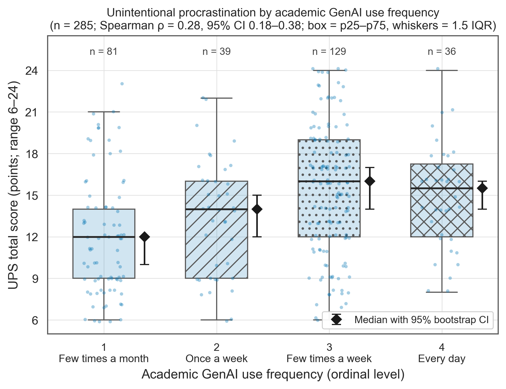
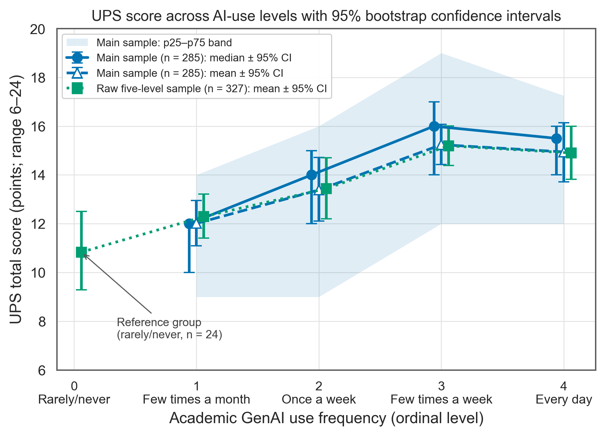
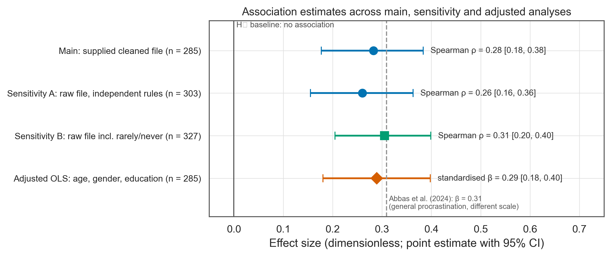
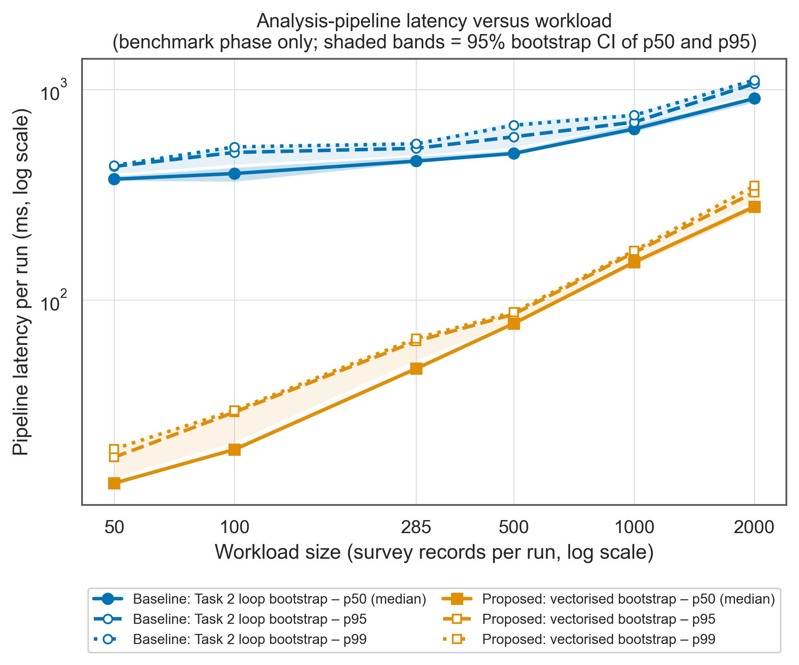
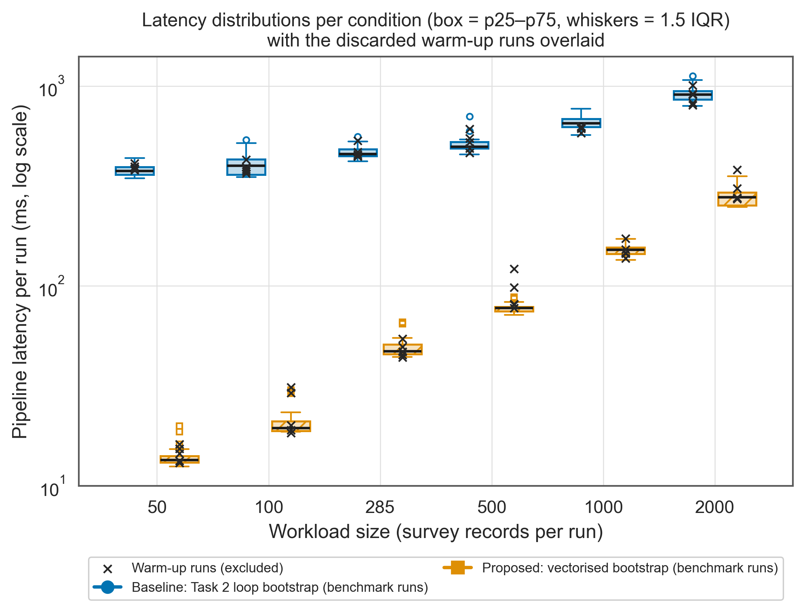
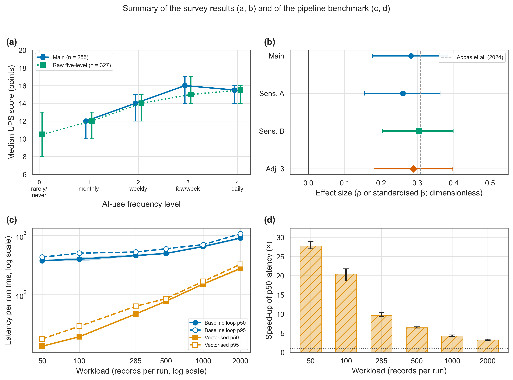

# 4. Experimental results and discussion

**Authors:** Ernur Kussain and Zhanassyl Zhakyp

This section reports the results of the Task 3 analysis. Equation numbers refer to the domain model in [`docs/domain_model.md`](../docs/domain_model.md); tables and figures are numbered within this section. All values are generated from `reports/results.json` and `data/processed/` by `src/build_report.py`. In the tables, bold marks the better value only where one direction is better (model fit, latency); association statistics are not highlighted.

## 4.1 Setup

The main sample has $n = 285$ bachelor's and master's respondents from the supplied cleaned workbook (Sharma et al., 2026). Two sensitivity samples are drawn from the raw workbook with our own rules: sensitivity A ($n = 303$) keeps academic GenAI users, and sensitivity B ($n = 327$) also keeps respondents who use GenAI rarely or never, coded as level 0. The exposure $x_i$ is the ordinal use frequency and the target $y_i$ is the six-item Unintentional Procrastination Scale total (Eq. 1). The primary metric is Spearman's coefficient

```math
\hat\rho_s = \operatorname{corr}\bigl(R(\mathbf{x}),\, R(\mathbf{y})\bigr), \qquad H_0:\ \rho_s = 0,
```

with a 95% percentile bootstrap interval over $B = 10\,000$ paired resamples (Eq. 4) and a permutation p-value (Eq. 6). The supplementary model compares the covariates-only baseline $M_0$ with the proposed model $M_1$, which adds $x_i$ (Eqs. 7 to 9). The pipeline benchmark times the Task 2 analysis on workloads of 50 to 2,000 records; latency percentiles exclude warm-up runs (Eqs. 15 and 16), and the speed-up is

```math
\mathcal{S}(w) = \frac{\mathrm{p}50_{\text{base},w}}{\mathrm{p}50_{\text{vec},w}} .
```

## 4.2 Primary association

**Table 1.** Association between academic GenAI-use frequency and UPS total. Intervals are 95% percentile bootstrap intervals; $H$ and $\varepsilon^2$ come from the Kruskal–Wallis test across use levels (Eq. 11).

| Analysis | $n$ | $\hat\rho_s$ [95% CI] | $p$ (asymptotic) | $p$ (permutation) | $H$ | $\varepsilon^2$ | Decision |
|:--|--:|:--|--:|--:|--:|--:|:--|
| Main: supplied cleaned workbook | 285 | 0.283 [0.177, 0.384] | 1.2e-06 | < 0.001 | 26.4 | 0.093 | reject $H_0$ |
| Sensitivity A: raw workbook, independent rules | 303 | 0.260 [0.155, 0.363] | 4.4e-06 | < 0.001 | 23.7 | 0.078 | reject $H_0$ |
| Sensitivity B: raw workbook, five levels | 327 | 0.305 [0.205, 0.399] | 1.8e-08 | < 0.001 | 34.0 | 0.104 | reject $H_0$ |

In the main sample $\hat\rho_s = 0.283$ (95% CI 0.177 to 0.384), and the interval excludes the null value. The permutation p-value is at its floor of $1/(B+1)$, so the asymptotic and resampling tests agree. Both raw-file analyses give estimates of similar size ($\hat\rho_s = 0.260$ and 0.305), so the authors' unexplained exclusions do not appear to drive the result. All bootstrap resamples were valid ($v = 1.00$), and the UPS items were internally consistent (Cronbach's $\alpha = 0.89$, Eq. 13).



**Figure 1.** Distribution of UPS totals (points, possible range 6 to 24) for each academic GenAI-use level in the main sample ($n = 285$). Boxes span p25 to p75, the centre line is the median and whiskers reach 1.5 IQR; jittered points are individual respondents; black diamonds with error bars are medians with 95% bootstrap intervals (10,000 resamples). Scores rise from monthly to a-few-times-a-week use and level off for daily users.

## 4.3 Comparison with the lowest-use reference group

**Table 2.** UPS score by use level and comparison with the reference group (Median (p25–p75) and Mean ± SD in UPS points). The largest Cliff's δ in each sample is in bold.

| Use level | $n$ | Median (p25–p75), points | Mean ± SD, points | Median difference vs reference [95% CI] | Cliff's $\delta$ [95% CI] | Holm $p$ |
|:--|--:|:--|:--|:--|:--|--:|
| *Main sample, reference = level 1* | | | | | | |
| 1: Few times a month | 81 | 12.0 (9–14) | 12.01 ± 4.29 | reference | reference |  |
| 2: Once a week | 39 | 14.0 (9–16) | 13.38 ± 4.23 | +2.0 [+0.0, +5.0] | 0.21 [-0.01, 0.42] | 0.067 |
| 3: Few times a week | 129 | 16.0 (12–19) | 15.24 ± 4.78 | +4.0 [+2.0, +6.0] | 0.39 [0.23, 0.53] | < 0.001 |
| 4: Every day | 36 | 15.5 (12–17) | 14.94 ± 3.77 | +3.5 [+2.0, +6.0] | **0.41 [0.21, 0.60]** | < 0.001 |
| *Sensitivity B, reference = level 0* | | | | | | |
| 0: Rarely/never | 24 | 10.5 (7–14) | 10.83 ± 4.11 | reference | reference |  |
| 1: Few times a month | 89 | 12.0 (9–15) | 12.29 ± 4.41 | +1.5 [-2.0, +4.0] | 0.19 [-0.08, 0.45] | 0.159 |
| 2: Once a week | 41 | 14.0 (9–16) | 13.44 ± 4.15 | +3.5 [+0.0, +6.5] | 0.36 [0.09, 0.62] | 0.032 |
| 3: Few times a week | 133 | 15.0 (12–19) | 15.20 ± 4.78 | +4.5 [+2.0, +8.0] | 0.51 [0.29, 0.69] | < 0.001 |
| 4: Every day | 40 | 15.5 (12–17) | 14.90 ± 3.64 | +5.0 [+2.0, +8.0] | **0.54 [0.28, 0.76]** | < 0.001 |

Respondents who use GenAI a few times a week or every day score 3 to 4 points higher than the monthly reference group and 4 to 5 points higher than the rarely/never group. Weekly users do not differ clearly from the monthly group. The effect sizes for the two highest levels ($\delta \approx 0.4$ to $0.5$) are medium to large by common conventions for Cliff's δ.



**Figure 2.** UPS score (points) across AI-use levels 0 to 4. Solid line with circles: main-sample medians; dashed line with open triangles: main-sample means; dotted line with squares: means in the raw five-level sample, which adds the rarely/never reference group at level 0. Error bars are 95% bootstrap intervals and the shaded band is the main-sample p25 to p75 range. The increase is steepest between levels 0 and 3.

## 4.4 Baseline versus proposed model

**Table 3.** Baseline model $M_0$ versus proposed model $M_1$, $n = 285$. The better value of each criterion is in bold.

| Model | Predictors | $R^2$ | adjusted $R^2$ | AIC | BIC |
|:--|:--|--:|--:|--:|--:|
| $M_0$ baseline | age, gender, education | 0.004 | -0.006 | 1691.0 | 1705.6 |
| $M_1$ proposed | $M_0$ + AI-use frequency | **0.086** | **0.072** | **1668.7** | **1687.0** |

The covariates alone explain almost none of the variance ($R^2 = 0.004$). Adding AI-use frequency raises $R^2$ to 0.086 ($\Delta R^2 = 0.081$; nested $F = 24.9$, $p$ < 0.001). The coefficient is $\hat\beta = 1.30$ UPS points per frequency level (HC3 95% CI 0.81 to 1.79), or $\beta_{\text{std}} = 0.29$ (95% CI 0.18 to 0.40). Treating frequency as categorical gives a similar gain ($\Delta R^2 = 0.093$). Residuals are not normal (Shapiro–Wilk $p = 0.001$), which is why HC3 errors are used; the Breusch–Pagan test does not indicate heteroscedasticity ($p = 0.18$).



**Figure 3.** Effect sizes with 95% intervals for the main analysis, both sensitivity analyses (Spearman ρ, percentile bootstrap) and the adjusted model (standardised β, HC3). The solid line is the null baseline $\rho_s = 0$ and the dashed line is the published β = 0.309 of Abbas et al. (2024), which used a different procrastination measure. All four intervals exclude zero and overlap one another.

## 4.5 Pipeline benchmark

**Table 4.** Latency per run in ms after warm-up filtering (successful runs only), with the p50 speed-up of the proposed implementation and its 95% bootstrap interval. The lower latency in each row is in bold.

| Records per run | Baseline p50 (p25–p75), ms | Proposed p50 (p25–p75), ms | Baseline p95 / p99, ms | Proposed p95 / p99, ms | Speed-up $\mathcal{S}$ [95% CI] |
|--:|:--|:--|:--|:--|:--|
| 50 | 374.6 (360.4–393.1) | **13.5** (13.1–14.1) | 430.7 / 435.2 | **17.9 / 19.6** | 27.80 [27.02, 28.92] |
| 100 | 398.5 (360.1–429.9) | **19.5** (18.9–21.0) | 501.9 / 533.3 | **29.3 / 29.9** | 20.44 [18.58, 21.76] |
| 285 | 456.4 (445.9–483.3) | **47.2** (45.5–51.0) | 524.8 / 551.5 | **63.7 / 65.6** | 9.67 [9.27, 10.31] |
| 500 | 496.2 (486.8–525.8) | **77.3** (74.7–78.5) | 595.5 / 675.7 | **85.6 / 87.6** | 6.41 [6.32, 6.67] |
| 1000 | 648.8 (622.8–684.4) | **151.2** (144.7–155.8) | 699.1 / 753.2 | **167.8 / 171.3** | 4.29 [4.13, 4.53] |
| 2000 | 905.3 (856.3–943.9) | **277.3** (252.6–293.5) | 1065.0 / 1107.4 | **324.7 / 348.1** | 3.26 [3.10, 3.41] |

The log holds 420 timed runs; 60 warm-up runs were discarded and 360 benchmark runs were analysed. They were collected on Intel(R) Xeon(R) Processor @ 2.80GHz with 2 logical CPUs and Python 3.12.3. On identical inputs the two implementations returned the same estimates (largest absolute difference 2.2e-16 over 155 paired runs), and the vectorised version was faster at every workload: from 3.3× at 2000 records to 27.8× at 50 records. At the study's own sample size of 285 records the median run time fell from 456.4 ms to 47.2 ms ($\mathcal{S} = 9.67$, 95% CI 9.27 to 10.31).

**Table 5.** Guardrail metrics (Eqs. 14, 18 and 19).

| Guardrail | Required | Observed |
|:--|:--|:--|
| Invalid or missing required values | 0 | 0 |
| Duplicate record IDs | 0 | 0 |
| Computed vs supplied UPS totals | all equal | 0 mismatches (300 audited) |
| Valid bootstrap resamples, $v$ | ≥ 0.95 | 1.00 |
| Unexpected error rate, $e$ | 0 | 0 |
| Invalid batches rejected, $d$ | 1 | 1 |
| Max difference between implementations | ≤ 10⁻⁹ | 2.2e-16 |

All 25 injected invalid batches were rejected by both implementations, and no unexpected error occurred.



**Figure 4.** Pipeline latency per run (ms, log scale) against workload (records per run, log scale) for the Task 2 loop bootstrap (circles) and the vectorised bootstrap (squares). Solid, dashed and dotted lines are p50, p95 and p99; shaded bands are 95% bootstrap intervals of p50 and p95. Warm-up runs are excluded. The gap between the implementations narrows as the workload grows.



**Figure 5.** Latency distributions (ms, log scale) of the benchmark runs for each workload and implementation; boxes span p25 to p75 and whiskers 1.5 IQR, with outliers flagged but kept. Black crosses are the discarded warm-up runs. Cold runs were at most about 1.6 times the benchmark median, so the warm-up effect is small in this pipeline.



**Figure 6.** Four-panel summary. (a) Median UPS score (points) per AI-use level in the main and five-level samples, with 95% bootstrap intervals. (b) Effect sizes (ρ or standardised β) with 95% intervals; the dashed line marks Abbas et al. (2024). (c) p50 and p95 latency (ms, log scale) against workload, with 95% bootstrap bands around p50. (d) p50 speed-up (×) of the vectorised implementation with 95% bootstrap intervals; the dotted line marks no speed-up.

## 4.6 Discussion

In this Indian sample, more frequent academic GenAI use goes with more unintentional procrastination. The size of the association ($\hat\rho_s = 0.283$) is close to the 75th percentile of correlations in individual-differences research (Gignac & Szodorai, 2016) and within the range of 2024–2026 studies of GenAI use or dependence and procrastination (about 0.23 to 0.43; Abbas et al., 2024; Galindo-Domínguez et al., 2026; Liu & Liu, 2026). The standardised coefficient of 0.29 is close to the β = 0.309 of Abbas et al. (2024).

The result is an association. The design is cross-sectional, and the strongest longitudinal evidence found so far points the other way: in a baseline-adjusted three-wave panel, GenAI-use frequency did not predict later procrastination (Zhao et al., 2026). The UPS correlates strongly with general procrastination and moderately with depression and anxiety (Fernie et al., 2017), so stable traits and distress, which the source data do not measure, may explain part of the association. Students who already procrastinate may also turn to GenAI more often.

For Kazakhstan no study yet measures GenAI use together with procrastination. GenAI use is already widespread among Kazakhstani students (65% weekly academic use in one 2024 survey of 840 students; Zhunusbekova & Askarkyzy, 2024), AI courses are compulsory, and universities set their own integrity rules. A frequency item may therefore vary less there and reflect course demands more than personal habit. Our result is best treated as a hypothesis for a Kazakhstani study that uses validated Kazakh and Russian versions of the UPS, measures the type of use and dependence as well as frequency, and follows students over several waves.

## References

Abbas, M., Jam, F. A., & Khan, T. I. (2024). Is it harmful or helpful? Examining the causes and consequences of generative AI usage among university students. *International Journal of Educational Technology in Higher Education, 21*, 10. https://doi.org/10.1186/s41239-024-00444-7

Fernie, B. A., Bharucha, Z., Nikčević, A. V., & Spada, M. M. (2017). The Unintentional Procrastination Scale. *Journal of Rational-Emotive & Cognitive-Behavior Therapy, 35*, 136–149. https://doi.org/10.1007/s10942-016-0247-x

Galindo-Domínguez, H., Sainz-de-la-Maza, M., Campo, L., & Losada-Iglesias, D. (2026). The influence of learning motivation and procrastination on ChatGPT dependence. *RIED-Revista Iberoamericana de Educación a Distancia, 29*(1), 217–240. https://doi.org/10.5944/ried.45497

Gignac, G. E., & Szodorai, E. T. (2016). Effect size guidelines for individual differences researchers. *Personality and Individual Differences, 102*, 74–78. https://doi.org/10.1016/j.paid.2016.06.069

Liu, Y., & Liu, Y. (2026). Association between perceived usefulness of generative AI for learning and generative AI dependency among university students in Changde, China. *Frontiers in Psychology, 17*, 1859317. https://doi.org/10.3389/fpsyg.2026.1859317

Sharma, P., Nandy, D., Ramchandani, G., James, A., Batra, M., & Dhanda, R. (2026). *Datasheets for Role of Generative Artificial Intelligence Usage on Academic Dishonesty Among Indian Undergraduate and Postgraduate Students* (Version 1) [Data set]. Mendeley Data. https://doi.org/10.17632/88pv88j8jb.1

Zhao, Y., Chen, J., Dai, W., & Gu, Y. (2026). Learning-centred use of generative AI and later academic functioning: A baseline-adjusted three-wave panel study. *Frontiers in Psychology, 17*, 1878514. https://doi.org/10.3389/fpsyg.2026.1878514

Zhunusbekova, A., & Askarkyzy, S. (2024). Students' perceptions of artificial intelligence use in higher education and its impact on academic integrity. *Pedagogy and Psychology, 61*(4), 145–155. https://doi.org/10.51889/2960-1649.2024.61.4.008
